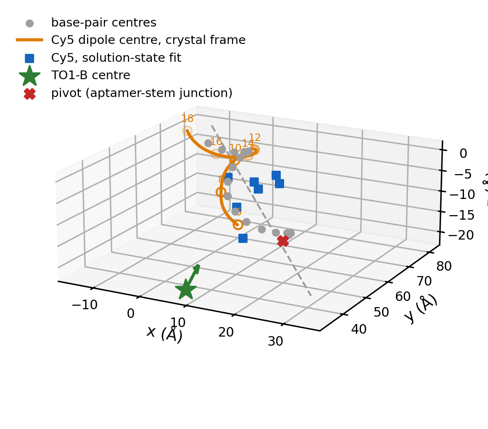

# aptamer_fret_ruler

Geometry and orientation-dependent FRET model for an RNA helical ruler. The
donor is the fluorogen TO1-B bound in the Mango II aptamer; the acceptor is a
Cy5 stacked on the terminal base pair of a duplex extension of 6 to 18 base
pairs. The measured efficiency oscillates with stem length, and the model
reproduces that oscillation through the orientation factor κ² as the acceptor
rotates about the helix.

This is the analysis code for Chapter 3 of the PhD thesis "Fluorogenic RNA
Mango Aptamers: Single-Molecule Characterisation and Applications in
CRISPR-Mediated Genomic Imaging" (Fangqi Liu, Imperial College London, 2026).



## Quick start

Python 3.9 or later with numpy, scipy and pandas.

```
git clone https://github.com/Fonzie3000/aptamer_fret_ruler.git
cd aptamer_fret_ruler
pip install -r requirements.txt
python geometry/build_ruler_geometry.py
python model/evaluate_fit.py
```

With conda, replace the `pip` line by `conda env create -f environment.yml`
and `conda activate aptamer_fret_ruler`.

The geometry step takes a few seconds and the model step under a minute. Both
write into `out/`, which is not tracked, so a run never overwrites `results/`.
Every path is resolved from the script's own location, so the commands work
unchanged on Linux, macOS and Windows and from any directory; on Windows, use
`python` rather than `python3`. `python model/evaluate_fit.py --quick` is a
sanity pass of a few seconds whose numbers are deliberately not the reported
ones.

## How it works

The analysis runs in two steps.

First, `geometry/build_ruler_geometry.py` places the donor and the acceptor of
every construct in one coordinate frame, using DSSR base-pair reference
frames. The TO1-B centre and transition dipole come from PDB 6C63 (ligand
EKJ). The Cy5 pose comes from PDB 5NS3 (ligand 5CY) and is expressed in the
frame of the base pair it stacks on, so that it can be transferred to any
terminal base pair. Each construct is superimposed on the Mango II stem by a
Kabsch fit of its conserved CGUAC block onto base pairs 2 to 6 of 6C63, and
the Cy5 pose is grafted onto its terminal base pair. The output is
`ruler_all_data.py`.

Second, `model/evaluate_fit.py` evaluates the FRET model at the reported fit.
It reads the stored geometry in `geometry/reference/`, so rebuilding the
geometry never changes what the model evaluates. Five parameters are free: a
tilt of the stem about the aptamer junction, the isotropic Förster radius, a
phase offset, a phase gain per base pair and the fraction of molecules that
transfer. κ² is averaged by Monte Carlo over libration cones of 45 deg on the
acceptor and 15 deg on the donor. A one-sided Gaussian penalty keeps the
active fraction at or above the largest measured efficiency, 0.814 ± 0.006 at
8 bp; every χ² reported is the data term alone, without that penalty. The
model is in `model/fret_model.py`, and the measured efficiencies are in
`model/ruler_constants.py`.

## What a rerun reproduces

The geometry step reproduces both files in `geometry/reference/` byte for
byte. The model step reproduces the stored tables in `results/`, which compare
with the thesis as follows.

| quantity | rerun | thesis |
|---|---|---|
| r_DA / Å, 6 to 18 bp | 21.2, 26.4, 33.9, 40.6, 45.1, 47.8, 50.7 | same |
| ⟨κ²⟩ | 0.204 to 0.790 | 0.20 to 0.79 |
| effective Förster radius / Å | 45.2 to 56.7 | 45 to 57 |
| active-fraction penalty | 3.34 | 3.3 |
| phase-gain profile minimum | +10 deg/bp, 27.7 ± 0.7 below the fit | same |
| data χ² | 79.07 | 78.52 |

The χ² and the predicted efficiencies are Monte Carlo averages, and the rerun
draws its seed pairs from a different stream from the one behind the thesis
table. They therefore differ in the third figure: χ² by 0.55, about one
standard error, and the predicted efficiency at 12 and 14 bp by about 0.002.

Two parts of the analysis are not in the repository. First, the optimisation
that produced the reported vector, which ran interactively (differential
evolution, then a multi-start local search, then a Nelder-Mead polish) and
whose configuration was not kept in runnable form. The vector itself is in
`results/fit_parameters.json`, so every number above is computed at the
reported fit rather than refitted. Second, the Förster radius from spectral
overlap, R0,iso = 50.3 Å, which was computed from digitised spectra that are
not included.

## Repository layout

| folder | content |
|---|---|
| `data/` | the two crystal structures and the nine DSSR pair-frame files that the geometry step reads |
| `data/construct_builds/` | the seven duplex extensions, read by DSSR only |
| `geometry/` | `build_ruler_geometry.py`, and `run_dssr.py` to repeat the DSSR step |
| `geometry/reference/` | the geometry the reported fit was computed on |
| `model/` | `fret_model.py`, `ruler_constants.py` and `evaluate_fit.py` |
| `results/` | the reported parameter vector, the refits at fixed phase gain that `evaluate_fit.py` reads, and its stored output tables |
| `figures/` | the assembled geometry shown above |

## Data

PDB 6C63 (chain A) and PDB 5NS3 are the two crystal structures. The seven
duplex extensions in `data/construct_builds/` are sequence-specific A-form
builds made in UCSF ChimeraX 1.10.1. Every pair-frame file comes from its
structure through `dssr analyze -i=<file>.pdb --more` with DSSR
v2.9.2-2026jul29. The raw fluorescence spectra behind the seven efficiencies
are not included; they are available from the author on request.

## DSSR

DSSR is a separate program under its own licence and is not distributed here;
it is free for academic users from https://x3dna.org/. The pair-frame files it
produced are included, so the geometry step runs without it.
`python geometry/run_dssr.py` repeats the DSSR step and reports, for each
structure, whether the new file is byte-identical to the included one.

If you use the geometry step, please cite DSSR:

Lu, X.-J., Bussemaker, H. J. and Olson, W. K. (2015) DSSR: an integrated
software tool for dissecting the spatial structure of RNA. Nucleic Acids
Research 43(21), e142. https://doi.org/10.1093/nar/gkv716

## Citation

If you use this code, please cite the thesis:

Liu, F. (2026) Fluorogenic RNA Mango Aptamers: Single-Molecule
Characterisation and Applications in CRISPR-Mediated Genomic Imaging. PhD
thesis, Imperial College London.

GitHub's "Cite this repository" button gives the same reference from
`CITATION.cff`.

## Licence

The code is released under the MIT licence; see `LICENSE`.

## Contact

Fangqi Liu, MRC Laboratory of Medical Sciences and Imperial College London.
